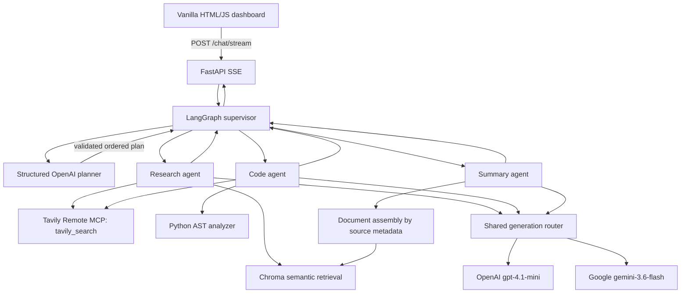

# Architecture — Developer Documentation Assistant

## Overview

A single-turn, stateless developer documentation assistant deployed to Google Cloud Run. FastAPI serves a vanilla HTML/CSS/JavaScript dashboard and a POST SSE endpoint. A LangGraph supervisor creates an ordered agent plan, delegates to specialized workers, and combines their results. Workers stream generated tokens using LangGraph custom events forwarded to the browser.

## State and orchestration

`AgentState` fields: `question` (original request), `selected_agent` (research/code/summary), `answer` (latest answer), `trace` (execution history), optional `plan` (ordered workers), `step` (next index), `agent_results` (worker outputs), `routing` (actual provider/model/reason), and `error` (worker failure). The structured planner selects one to three agents and provides a rationale; a deterministic keyword planner is used if LLM planning fails. Workers return to the supervisor after execution. The supervisor stops on an error instead of sending downstream workers incomplete findings. The multi-agent output is assembled from `agent_results` in plan order.

The service is intentionally **single-turn and stateless across requests**: `agent_results` exists only during a graph invocation, and there is no claim of durable conversation memory. The bundled Chroma index is retrieval data, not user conversation state.

## Agent responsibilities and tools

| Agent | Specialized system behavior | Tool access |
|---|---|---|
| Research | Grounded technical explanations with exact chunk-ID citations | Chroma top-k retrieval and live Tavily `tavily_search` through Remote MCP |
| Code | Python code analysis, bug identification, implementation examples; never claims execution without testing | Python AST extraction/analysis and the **same** Tavily MCP search tool for current API questions; can consume prior research findings |
| Summary | Concise document synthesis with citation preservation | Finds relevant source and assembles its indexed chunks in original order, capped at 24,000 characters |

MCP-sharing rationale: Research and Code invoke the same Tavily MCP-backed `search_web` tool in different contexts. Both invocation traces were verified in the deployed application. The Code Agent is not a sandboxed code executor: AST checks structure but do not prove runtime correctness.

## LLM routing

| Condition | Preferred provider / model | Rationale |
|---|---|---|
| Complexity score = 0 | Google / `gemini-3.6-flash` | Cost-efficient generation for straightforward requests |
| Complexity score >= 1 | OpenAI / `gpt-4.1-mini` | More reasoning-oriented tasks |
| Code Agent | Adds one to complexity score | Prefer OpenAI for code work |
| Gemini 429 or 503 **before** streamed text | Fallback to OpenAI | Availability / quota resilience |

Complexity is a **keyword heuristic**, not a calibrated capability benchmark. Signals include `debug`, `analyze`, `refactor`, `optimize`, `compare`, `architecture`, `tradeoff`, and `security vulnerability`. The actual provider and fallback reason are exposed in the trace and UI. If Gemini fails after text was emitted, the system does not merge incompatible partial generations.

## RAG pipeline

1. **Ingestion:** Load FastAPI technical documentation from `data/raw`, split into indexed chunks, assign IDs such as `fastapi/tutorial/dependencies/index.md::0` and metadata `source`, `technology`.
2. **Embeddings:** OpenAI `text-embedding-3-small` for document and query vectors.
3. **Storage:** Chroma `PersistentClient`, collection `developer_docs`; **2,545 indexed chunks**. Local default is project-root `chroma_index`; Cloud Run uses `CHROMA_PATH=/app/chroma_index`.
4. **Retrieval:** Chroma vector similarity query, top **k=5**; optional experimental distance filter. Multi-query/RRF retrieval exists as an experimental alternative, not the default.
5. **Augmentation:** Concatenate exact `[chunk_id]`, source, and text into a prompt instructing the model to use only supplied documentation, cite individual chunk IDs, and acknowledge unsupported claims.
6. **Generation and checks:** Stream actual model output through LangGraph and SSE; check whether cited IDs exist among retrieved chunks. This **ID validation does not establish factual support**. The Summary Agent instead assembles chunks of one source document.

**Corpus limitation:** The summary tool picks a single top-ranked source and may miss other documents; a character cap may omit the end of long documents. Some citation URL mappings (e.g. `.txt` or index paths) may not correspond to published pages. Chroma is packaged as a deployment-time snapshot, not updated automatically.

## Deployment and security

Google Cloud Run service `developer-docs-assistant`, region `us-west2`, deployed image in Artifact Registry repository `docs-assistant`. Container runs FastAPI/Uvicorn on Cloud Run's `PORT`, bundles the Chroma index, and receives OpenAI, Google and Tavily keys from Secret Manager via a dedicated service account. The public dashboard supports genuine SSE token streaming and inspectable trace/routing. No `.env` or credentials belong in the source archive. The public unauthenticated demo has no application-level rate limiting and should not be represented as production-hardened.

Live service: https://developer-docs-assistant-let7krnqfa-wl.a.run.app

## Known limitations

- Streaming tokens can become visible before citation validation completes; show a warning for rejected citations.
- Provider quotas and 503 errors can interrupt generation; fallback works for 429/503 before the first token.
- No durable multi-turn conversation memory by design.
- No execution-based validation of generated code; AST alone does not catch all runtime errors.
- Additional regression testing is warranted for multi-agent errors, incomplete streams, and arbitrary user queries.
